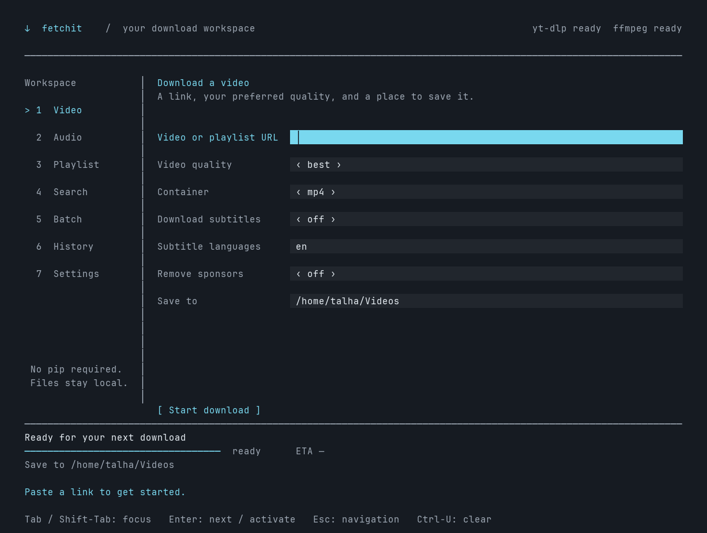

# Fetchit

A video downloader that feels at home in your terminal. Full-screen forms,
keyboard navigation, live progress, YouTube search, history, and saved defaults.
Built with Python's standard library; no pip packages or virtual environment.

## Launch

```bash
./fetchit-cli
# or
python3 -m fetchit
```

Python 3.10+, `yt-dlp`, and `ffmpeg` must be available on PATH. The full-screen
interface runs in Linux/macOS terminals with Python curses support. Use a
terminal of at least 60 columns × 20 rows; 100 × 32 or larger is more comfortable.
Unsupported terminals use the numbered prompt interface. Piped input without a
target shows help instead of hanging at a prompt. `NO_COLOR=1` disables colors.



The sidebar opens Video, Audio, Playlist, Search, Batch, History, and Settings.
The transfer panel stays visible while you browse other screens. Search results
open a prefilled video form. Batch files contain one URL per line; yt-dlp also
accepts comment lines. One command runs at a time, including playlist and batch
jobs. History records that command's outcome; it does not independently certify
every item in a multi-target download.

## Keyboard controls

| Key | Action |
| --- | --- |
| Arrow keys | Choose a screen from navigation; move between form fields |
| 1–7 | Open a screen while navigation has focus |
| Tab / Shift-Tab | Move between navigation, fields, and the action button |
| Enter | Open a form, advance a text field, toggle a choice, or activate a button |
| Left / Right | Change a choice or move the text insertion point |
| Home / End or Ctrl-A / Ctrl-E | Move to the beginning or end of a text field |
| Ctrl-U | Clear a text field |
| Escape | Return to navigation; return from search results to a new search |
| Ctrl-X | Cancel the active download or search |
| q | Quit while navigation has focus; cancels any active job |
| Ctrl-C | Cancel an active job; exit when idle |

Paste a URL, Tab through the choices, then press Enter on **Start download**.
Drafts survive screen switches and errors. Fields scroll into view as focus
moves. A terminal resize preserves entered values. Cancellation keeps partial
files so yt-dlp can resume later. A 100% media transfer still waits for merging,
audio conversion, and other postprocessing before reporting completion.

Settings saves defaults for new forms and CLI commands. Invalid saved values
fall back to safe defaults; failed writes preserve the previous file. Saving
settings resets existing form drafts to the new defaults.

## Direct commands

Existing one-liners still work. Flags can appear before or after URLs.

```bash
# best available quality, mp4 container
./fetchit-cli "https://www.youtube.com/watch?v=VIDEO_ID"

# 720p video
./fetchit-cli URL -q 720 -f mp4

# audio only
./fetchit-cli --audio-only --audio-format mp3 URL

# playlist slice, or just the video from a playlist link
./fetchit-cli --playlist-start 1 --playlist-end 5 URL
./fetchit-cli --no-playlist URL

# subtitles, including automatic captions, and embedding
./fetchit-cli --subs --auto-subs --subs-lang en --embed-subs URL

# remove sponsor segments
./fetchit-cli --sponsorblock remove URL

# URLs from a file
./fetchit-cli -a urls.txt

# search and download top three, or only print result URLs
./fetchit-cli --search "lofi hip hop" --max-results 3
./fetchit-cli --search "lofi hip hop" --print-url

# review commands without downloads, searches, folder creation, or history writes
./fetchit-cli --dry-run -q 1080 URL
./fetchit-cli --dry-run   # open the terminal app in preview mode

# overwrite an existing download; resume is the normal default
./fetchit-cli --force URL

# pass extra options to yt-dlp after a bare --
./fetchit-cli URL -- --write-description --sleep-interval 2

./fetchit-cli --help
```

Container choices use merging and remuxing; incompatible source codecs may
still require a different container. Thumbnail/metadata embedding is enabled
by default and can be disabled in Settings or with the corresponding CLI flags.
Live-site availability, authentication, rate limits, and extraction behavior are
handled by your installed [yt-dlp](https://github.com/yt-dlp/yt-dlp#usage-and-options).

## Config and history

- Config: `~/.config/fetchit/config.json`
- History: `~/.local/share/fetchit/history.json` (up to 500 command outcomes)
- Log: `~/.local/share/fetchit/fetchit.log`

`XDG_CONFIG_HOME` and `XDG_DATA_HOME` override the base folders.
Use `--show-config`, `--save-as-default`, `--history`, or `--clear-history` for
command-line access. Dry runs do not write history. Explicit actions such as
saving settings or clearing history still work in preview mode.

Optional command link:

```bash
mkdir -p ~/.local/bin
ln -sf "$PWD/fetchit-cli" ~/.local/bin/fetchit
```

## Verify

```bash
python3 -m unittest discover -s tests -v
python3 -m compileall -q fetchit tests
```

Tests use isolated temporary storage and fake downloader processes. The POSIX
terminal integration test exercises actual curses startup, screen navigation,
text entry, resizing, live progress, cancellation, and terminal restoration.

## YouTube without browser setup

Normal downloads do not read your browser session. If YouTube blocks the normal
extraction attempt with a bot-check or HTTP 429, Fetchit tries one alternative
public-player route automatically, before any media starts downloading. Both
the terminal interface and direct commands use this fallback. Explicit cookie
or player options are respected; they disable this automatic alternative.

This route was checked against the reported video without cookies, including
availability checks of its video and audio streams. YouTube can still restrict
particular videos or connections; anonymous extraction cannot guarantee access
to every video or every requested resolution.
